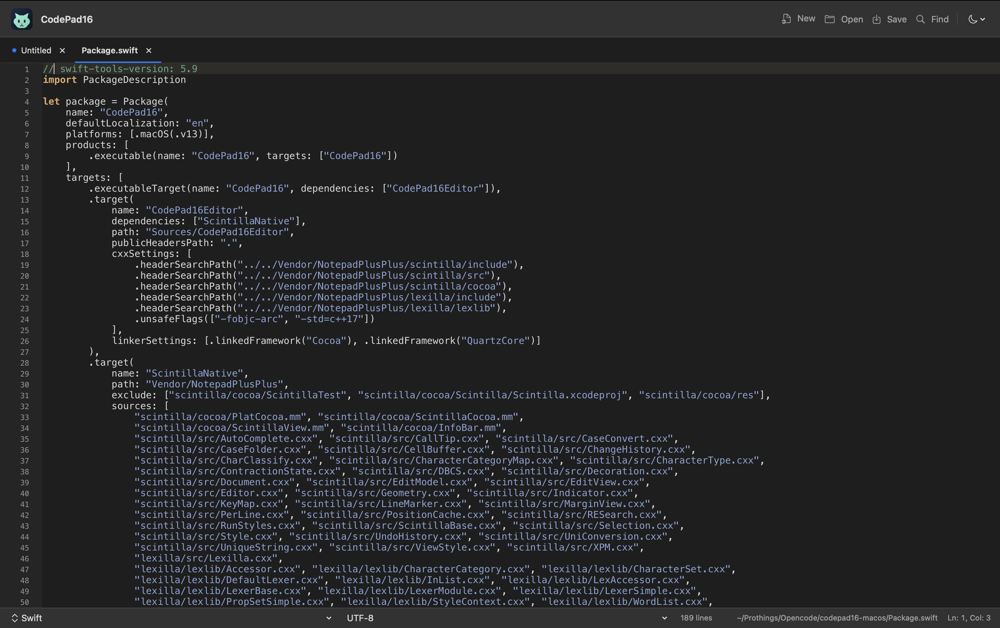

# CodePad16 for macOS

A small, native macOS text and code editor prototype for Apple Silicon. It is an independent project with a familiar tabbed-editor workflow; it is not an official Notepad++ release and is not affiliated with the Notepad++ project.



## Current features

- Native macOS window and controls, built with SwiftUI and AppKit
- Matching cat logo in the app icon and window header
- Multiple open documents in tabs
- New, open, save, and save as
- UTF-8, UTF-16, UTF-32, and ISO-8859-1 text files, detected on open and preserved on save
- Native Find interface (`⌘F`)
- Syntax highlighting and automatic language detection for C, C++, C#, Java, JavaScript, TypeScript, Python, Swift, HTML, CSS, JSON, XML, and SQL
- A language-mode picker for changing the detected mode
- Scintilla line-number gutter
- Restores the previous session on launch, including open tabs, cursor and scroll position, language, encoding, and unsaved changes
- Unsaved-change indicator and close confirmation
- Encoding label and line count
- Menu and keyboard shortcuts for common actions

This is a prototype, not feature parity with Notepad++. Plugins and advanced search are not implemented yet. Swift uses the C-family lexer as an initial approximation.

## Build on Apple Silicon

Requirements: macOS 13 or later and Xcode Command Line Tools (Swift 5.9 or later).

```sh
git clone https://github.com/mpschahal16/codepad16-macos.git
cd codepad16-macos
./scripts/build-app.sh
open dist/CodePad16.app
```

The script builds for the host architecture. Run it on an Apple Silicon Mac to produce an `arm64` app. The app is ad-hoc signed for local testing, but it is not Developer ID signed or notarized, so macOS may show a security prompt when opening it.

To package the built app as a drag-to-Applications disk image, run:

```sh
./scripts/make-dmg.sh
```

This creates `dist/CodePad16-macOS-arm64.dmg`. Build the app first with `./scripts/build-app.sh` if `dist/CodePad16.app` is missing.

## How the Notepad++ source informed the design

The linked source separates application-level command handling (`PowerEditor/src/Notepad_plus.cpp` and `NppCommands.cpp`), document and file state (`ScintillaComponent/Buffer.*`), and the editor view (`ScintillaComponent/ScintillaEditView.*`, backed by Scintilla and Lexilla). CodePad16 uses the upstream Scintilla editor and Lexilla lexer sources for syntax coloring, while keeping the document lifecycle and interface native to macOS.

The editable SVG is in `Assets/cat-logo.svg`; the matching Core Graphics renderer is in `scripts/render-icon.swift`. Regenerate the ICNS bundle with `./scripts/make-icon.sh`.

Scintilla and Lexilla are distributed under their permissive license in `Vendor/NotepadPlusPlus/licenses/Scintilla-Lexilla-License.txt`. The project is licensed under GPL-3.0-or-later; read `LICENSE` and the third-party license before redistributing.

## Acknowledgments

Thank you to Don Ho ([don.h@free.fr](mailto:don.h@free.fr)) and the Notepad++ contributors for building Notepad++ and for making its source code available as open source. CodePad16 would not exist without that work: the Notepad++ source described above was the reference for this editor's design, and it is the upstream source for the bundled Scintilla and Lexilla code in `Vendor/NotepadPlusPlus/`. We are grateful to the Notepad++ developer and community for keeping the project open.

Thanks also to Neil Hodgson and the Scintilla and Lexilla contributors, whose editor components Notepad++ itself builds on.

## Open-source status

Contributions and issue reports are welcome. Please use the name and visual identity of this independent project when publishing it; do not present it as an official Notepad++ macOS release.
